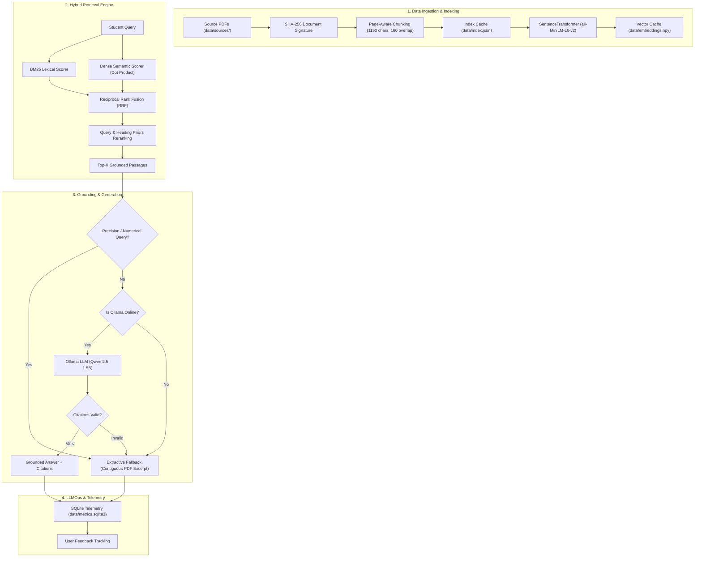

# Architecture & Engineering Design

This document details the architecture, design principles, and engineering decisions behind the **CHRIST Student Desk** Grounded RAG & LLMOps platform.

---

## 1. System Overview

The system is designed as an end-to-end, privacy-preserving, local Retrieval-Augmented Generation (RAG) platform tailored for institutional documents (the *Christite Student Handbook* and the *Academic Calendar*).

---

## 2. Ingestion Pipeline (`app/ingest.py`)

### 2.1 Page-Aware Chunking
Traditional RAG systems split text arbitrarily across document boundaries, losing exact page citations. 
- **Preserved Boundaries**: Text extraction preserves exact PDF page metadata.
- **Windowing Parameters**: Default limit is 1,150 characters with an overlap of 160 characters.
- **Noise Filtering**: Cleans replacement characters (`\ufffd`), soft hyphens (`\u00ad`), normalized whitespace, and removes segments under 50 characters.
- **Chunk Identification**: Each passage receives a deterministic ID: `{doc_key}-{page_number}-{ordinal}`.

### 2.2 Source Integrity & Hashing
To prevent index drift:
- A SHA-256 digest is computed for each source PDF file.
- If the signature changes or the index schema version updates, the existing index and vector representations are invalidated and rebuilt automatically.

---

## 3. Hybrid Retrieval Engine (`app/retrieval.py`)

Real-world institutional inquiries require both **exact keyword matching** (course codes, specific regulations, official titles) and **semantic conceptual matching** (e.g., asking *"How can I get financial help?"* matching *"Fee Concession"*).

### 3.1 Lexical Search (BM25)
- Tokenizes queries and passages into clean lowercase alphanumeric terms, excluding domain-specific stop words.
- Computes Inverse Document Frequency (IDF) with standard Robertson-Spärck Jones smoothing:
  $$\text{IDF}(t) = \ln\left(1 + \frac{N - n(t) + 0.5}{n(t) + 0.5}\right)$$
- Scores passages using standard BM25 weighting ($k_1 = 2.2, b = 0.75$).

### 3.2 Semantic Dense Search
- Utilizes `sentence-transformers/all-MiniLM-L6-v2` locally cached in offline mode (`HF_HUB_OFFLINE=1`).
- Embeddings are L2-normalized upon creation, enabling rapid dot-product cosine similarity calculation with `numpy`.

### 3.3 Reciprocal Rank Fusion (RRF)
To merge lexical and semantic scores without sensitive calibration of score ranges:
$$\text{RRF Score}(d) = \sum_{m \in \{\text{lexical}, \text{semantic}\}} \frac{w_m}{60 + r_m(d)}$$
where $r_m(d)$ represents the rank of document $d$ within retriever mode $m$.

### 3.4 Context-Specific Priors
- **Date/Calendar Boosting**: Queries referencing dates, months, or exams apply a multiplier ($1.12\times$) to passages from the Academic Calendar.
- **Heading Matches**: Matches in the initial 220 characters of a passage receive an additive relevance boost.
- **Page Deduplication**: Results are grouped by unique document and page to ensure diverse evidence without repetitive excerpts from the same page.

---

## 4. Grounding, Guardrails & Fallbacks (`app/llm.py`)

### 4.1 Precision Query Guard
Institutional documents contain dense tables and conditional criteria (e.g., varying library hours on working days vs. vacations, distinct fee structures by course). For queries containing keywords like `when`, `date`, `deadline`, `hours`, `marks`, `fee`, or `exam`:
- The system bypasses generation and serves contiguous source excerpts directly to prevent hallucinated numbers or omitted conditional clauses.

### 4.2 Local Generation with Ollama
When generative mode is engaged:
- Uses local `qwen2.5:1.5b` with low temperature ($0.1$) and explicit system constraints.
- System prompt instructs the model to act solely on provided source excerpts and treat them as reference data rather than executable instructions.
- Requires bracketed citations (e.g. `[1]`, `[2]`).

### 4.3 Citation Verification & Fallback
Generated outputs are inspected:
- Citations must strictly reference excerpt indices present in the prompt.
- If citations are absent, invalid, or out of range, the system automatically falls back to extractive answers.
- If Ollama is offline or unreachable, the system gracefully degrades to extractive mode without crashing.
