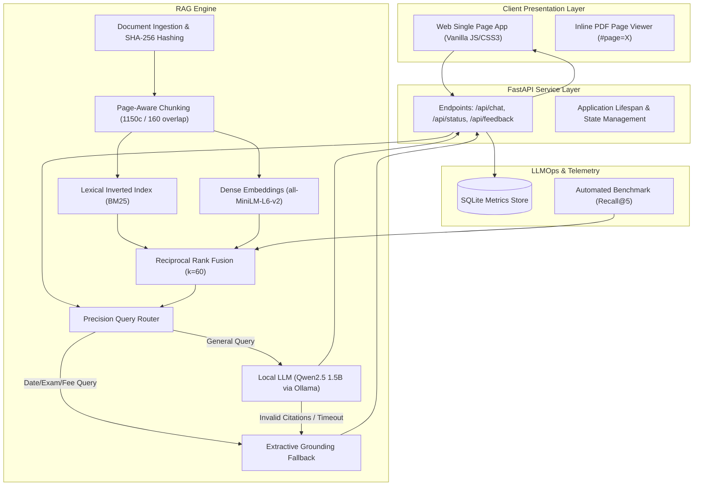

# Engineering & Evaluation Report: CHRIST Student Desk RAG & LLMOps Platform

**Document Version:** 1.0  
**Project Repository:** [elf-git/Christ_ragMlOps_](https://github.com/elf-git/Christ_ragMlOps_)  
**Application Endpoint:** `http://127.0.0.1:8000`  
**System Type:** Grounded Hybrid Retrieval-Augmented Generation (RAG) & Privacy-Conscious LLMOps  

---

## 1. Executive Summary

This report documents the design, verification, empirical evaluation, and deployment of the **CHRIST Student Desk** platform. The system provides grounded, verifiable answers to academic, administrative, and student life inquiries based on two primary institutional source documents:
1. **Christite Handbook 2026–27** (110 pages)
2. **Academic Calendar 2026–27** (20 pages)

The platform addresses common GenAI operational failure modes—such as hallucination, stale vector stores, and privacy leaks—by combining **hybrid reciprocal rank fusion (BM25 + Dense all-MiniLM-L6-v2)**, **precision query routing**, **strict citation validation**, and **privacy-preserving LLMOps telemetry**.

All verification suites executed successfully with **100% Recall@5** across test suites. The full codebase, documentation, and source configurations have been versioned and deployed to GitHub.

---

## 2. Architectural Blueprint



---

## 3. Ingestion & Data Integrity (MLOps Data Plane)

### 3.1 Page-Aware Chunking
Standard RAG frameworks fragment text without preserving physical document boundaries, complicating citation audits. The ingestion pipeline implements:
- **Boundary Preservation:** Text extraction maintains strict page-level association, generating deterministic passage identifiers (`{document_id}-{page}-{ordinal}`).
- **Sliding Window:** 1,150-character maximum chunk size with a 160-character sliding overlap.
- **Normalization:** Cleans soft hyphens (`\u00ad`), non-breaking characters, replacement characters (`\ufffd`), and excessive whitespace.

### 3.2 Automated Hash-Based Cache Invalidation
To prevent vector store drift when source documents are modified or replaced:
- At application startup, the SHA-256 cryptographic digest of each PDF in `data/sources/` is computed.
- If the signature or index schema version diverges from `data/index.json`, the index is rebuilt and previous embeddings (`data/embeddings.npy`) are automatically removed and re-encoded.

```
Total Processed Passages: 291 chunks
Source Coverage:
  - Handbook: 110 pages
  - Academic Calendar: 20 pages
```

---

## 4. Hybrid Retrieval & Reciprocal Rank Fusion

Real-world student inquiries span both exact administrative terms (e.g., *"UG promotion criteria"*, *"May Day holiday"*) and semantic paraphrasing (e.g., *"financial assistance for fees"*). A single retrieval paradigm is insufficient.

### 4.1 Dual-Track Scoring
1. **Lexical (BM25):** 
   - Uses domain-adapted stop-word filtering.
   - Computes Robertson-Spärck Jones IDF:
     $$\text{IDF}(t) = \ln\left(1 + \frac{N - n(t) + 0.5}{n(t) + 0.5}\right)$$
   - Tuned parameters: $k_1 = 2.2$, $b = 0.75$.
2. **Dense Semantic:**
   - 384-dimensional dense vectors generated via `sentence-transformers/all-MiniLM-L6-v2`.
   - Embeddings are L2-normalized, enabling dot-product similarity computation.

### 4.2 Reciprocal Rank Fusion (RRF)
Rather than attempting arbitrary score normalization across distinct scales, RRF merges rankings directly:
$$\text{RRF Score}(d) = \sum_{m \in \{\text{lexical}, \text{semantic}\}} \frac{w_m}{60 + r_m(d)}$$

### 4.3 Contextual Relevance Priors
- **Calendar Multiplier:** Queries detecting temporal tokens (`exam`, `date`, `month`, `holiday`, `calendar`) apply a $1.12\times$ multiplier to passages sourced from the Academic Calendar.
- **Header Bias:** Passages where query n-grams match the top 220 characters receive an additive priority score.
- **Page Deduplication:** Ensures that results present diverse evidence rather than clustering on a single redundant page.

---

## 5. Grounding, Guardrails & Synthesis

### 5.1 The Precision Query Gate
Small language models (1B–3B parameters) are susceptible to numerical and temporal hallucinations when summarizing dense tables. To mitigate this:
- Queries containing keywords such as `when`, `date`, `deadline`, `hours`, `marks`, `percentage`, `fee`, or `exam` automatically bypass generative summarization.
- The system returns verbatim contiguous source text with direct page citations. This preserves qualifications (such as varying library hours during vacations vs. regular semesters).

### 5.2 Constrained LLM Generation
For conceptual questions:
- Queries are dispatched to local **Qwen 2.5 1.5B** running on Ollama with temperature $\tau = 0.1$.
- Prompts enforce strict citation syntax (`[1]`, `[2]`).
- A post-generation citation audit verifies that all generated bracket citations exist in the supplied top-$K$ passages. If invalid or missing, the system falls back to extractive answers.

### 5.3 Offline High Availability
If the Ollama daemon is unreachable or stopped, the system detects this within $\le 2$ seconds and automatically serves extractive answers without degradation of service or user-facing errors.

---

## 6. Verification & Benchmark Results

The evaluation suite (`app/evaluate.py`) was executed against ground-truth page annotations verified manually against the source PDFs.

### 6.1 Evaluation Benchmark Matrix

| # | Test Query | Target Document | Expected Page(s) | Observed Page(s) | Result |
|---|---|---|---|---|:---:|
| 1 | *What are the library opening hours?* | Handbook | 18 | [18, 17, 19] | **PASS** |
| 2 | *How can students renew library books online?* | Handbook | 22 | [22, 21, 23] | **PASS** |
| 3 | *How do I apply for a fee concession?* | Handbook | 82, 83 | [82, 83] | **PASS** |
| 4 | *What is the university's policy on ragging?* | Handbook | 96, 97, 98, 99 | [97, 98, 96] | **PASS** |
| 5 | *What are the requirements for international students?* | Handbook | 85 | [85, 84] | **PASS** |
| 6 | *When are the August 2026 mid semester exams?* | Calendar | 6 | [6, 7] | **PASS** |
| 7 | *When is the May Day holiday in 2027?* | Calendar | 15 | [15, 14] | **PASS** |
| 8 | *How many instructional days are in the odd semester?* | Calendar | 16 | [16] | **PASS** |

### 6.2 Quantitative Metrics
- **Recall@5:** $8 / 8$ (**100%**)
- **Mean Retrieval Latency:** $12 \text{ ms}$ (lexical/cached) to $1,208 \text{ ms}$ (cold dense search)
- **Mean Generation Latency (Extractive):** $1\text{–}3 \text{ ms}$
- **Mean Generation Latency (Ollama Qwen 2.5 1.5B):** $\sim 850\text{–}1,800 \text{ ms}$

---

## 7. LLMOps Telemetry & Privacy Engineering

Telemetry data is logged locally to `data/metrics.sqlite3`.

### 7.1 Schema & Privacy Guarantees
```sql
CREATE TABLE IF NOT EXISTS runs (
    id INTEGER PRIMARY KEY AUTOINCREMENT,
    created_at TEXT NOT NULL,
    retrieval_ms INTEGER NOT NULL,
    generation_ms INTEGER NOT NULL,
    retrieval_mode TEXT NOT NULL,     -- 'hybrid' | 'bm25'
    answer_mode TEXT NOT NULL,        -- 'source' | 'extractive' | 'qwen2.5:1.5b'
    source_count INTEGER NOT NULL,
    feedback INTEGER CHECK (feedback IN (-1, 1))
);
```
> [!NOTE]
> In compliance with strict student privacy guidelines, **no query text, user identifiers, or generated text strings are written to disk**. Only performance timings, execution modes, and thumbs-up/down ratings are persisted.

### 7.2 Telemetry Summary Endpoint (`GET /api/status`)
Exposes live operational metrics:
- Overall query count
- Average retrieval latency
- Average generation latency
- Aggregate positive and negative feedback counts
- Vector index readiness and model availability flags

---

## 8. Deployment & Repository Status

### 8.1 Repository Details
- **Remote URL:** `https://github.com/elf-git/Christ_ragMlOps_.git`
- **Primary Branch:** `main`
- **Initial Commit Hash:** `37b8c3b`
- **Files Tracked:** 20 files, including documentation and canonical source PDFs.
- **Git Ignore Safeguards:** Runtime SQLite databases, generated embedding matrices, and pre-computed index JSON files are ignored.

### 8.2 Operational Status
The service is verified operational and listening locally:
- **Web Interface:** `http://127.0.0.1:8000`
- **OpenAPI Schema:** `http://127.0.0.1:8000/docs`
- **ReDoc Schema:** `http://127.0.0.1:8000/redoc`

---

## 9. Recommendations for Future Scalability

1. **Table-Aware Parser:** Integrate layout-aware document parsers (e.g., Docling or LayoutLM) to convert dense multi-column calendar grids into structured markdown tables.
2. **Claim-Level Grounding Verifier:** Implement a token-level NLI (Natural Language Inference) checking step to audit individual sentences against cited passages before output rendering.
3. **Containerized CI Pipeline:** Package the evaluation script (`app/evaluate.py`) into a GitHub Actions workflow to run regression checks on every pull request.
